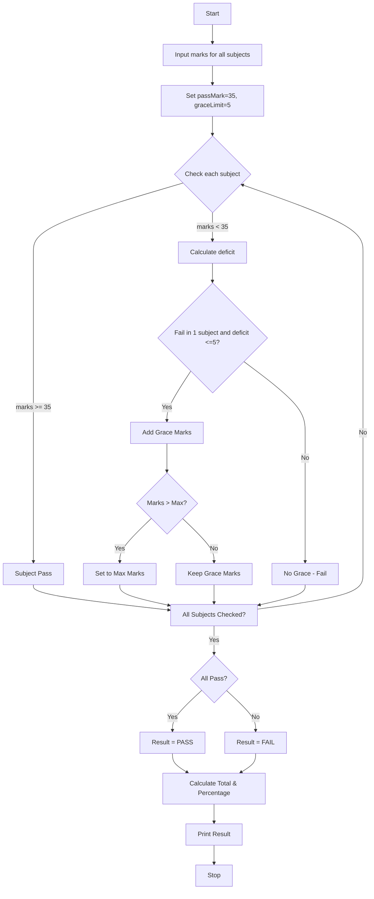

## PROBLEM STATEMENT
* Examination Result and Grace-Mark Validation: Process marks across multiple subjects, apply subject-wise pass criteria and a specified grace-mark policy, and generate final classifications without exceeding maximum marks. 
 
## ALGORITHM
1. Start
2. Input number of subjects, max marks (100) and pass marks (35)
3. Input marks for each subject
4. For each subject, check if marks >= 35, else calculate deficit = 35 - marks
5. If deficit <= 5 and student fails in only 1 subject, add grace marks
6. Check that grace marks do not make total > maximum marks
7. If all subjects pass after grace, Result = PASS, else FAIL
8. Calculate total and percentage and print classification
9. Stop
## FLOWCHART(MERMAID CODE)

 
## SAMPLE INPUT
Enter marks of all subjects separated by space: 65 78 33 55 70

## SAMPLE OUTPUT
Grace of 2 marks applied in Subject 3
