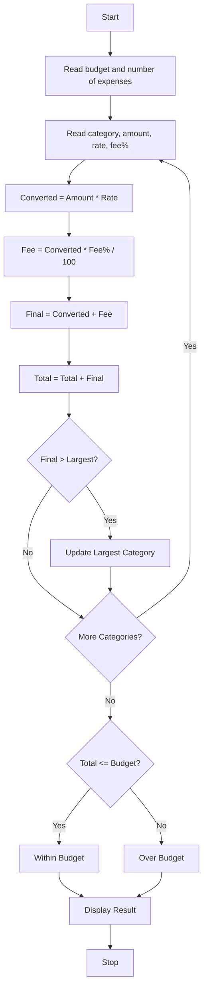

### Problem Statement:
 Multi-Currency Travel Budget Analysis: Convert travel expenses using supplied exchange rates, incorporate conversion fees, compare planned spending against a budget, and identify the largest expense category. 

### Algorithm:
1. Start
2. Read budget in INR
3. Read number of expense categories
4. For each category, read name, amount, exchange rate, fee %
5. Calculate Converted = Amount _ Rate
6. Calculate Fee = Converted _ Fee% / 100
7. Calculate Final = Converted + Fee
8. Add Final to Total
9. Track largest expense
10. After all categories, compare Total with Budget
11. Display Total, Largest, and Budget status
12. Stop

### Flowchart:

### Sample Input:
Enter budget in INR: 100000
Enter number of expense categories: 2

Enter category: Hotel
Enter amount in foreign currency: 500
Enter exchange rate: 85
Enter conversion fee %: 2

Enter category: Food
Enter amount in foreign currency: 200
Enter exchange rate: 85
Enter conversion fee %: 2

### Sample Output:
Hotel: INR 43350.00
Food: INR 17340.00

Travel Budget Report 
Total Spending: INR 60690.0
Largest Expense: Hotel - INR 43350.0
Status: Within Budget

