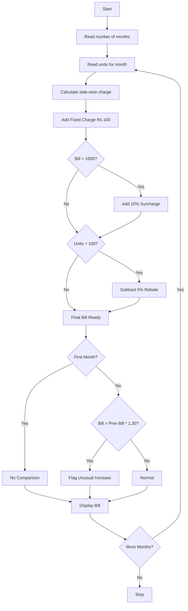

### Problem Statement:
 Progressive Electricity Billing: Calculate household bills using multiple consumption slabs, fixed charges, surcharges, and rebates, then compare bills across several months and identify unusual increases.

### Algorithm:
1. Start
2. Read number of months
3. For each month, read units consumed
4. Calculate slab-wise charge:
   - If units <= 100, charge = units _ 3
   - Else if units <= 200, charge = 100_3 + (units-100)_5
   - Else if units <= 300, charge = 100_3 + 100_5 + (units-200)_7
   - Else charge = 100_3 + 100_5 + 100_7 + (units-300)_9
5. Add fixed charge Rs. 100 to get total bill
6. If total bill > 1000, add 10% surcharge
7. If units < 100, subtract 5% rebate
8. Store the bill for this month
9. Compare with previous month bill. If increase > 30%, flag as Unusual Increase
10. Display month, units, bill and status
11. Stop

### Flowchart:

### Sample Input:
Enter number of months: 3
Enter units for Month 1: 90
Enter units for Month 2: 150
Enter units for Month 3: 280
### Sample Output:*
Month | Units | Bill | Status
Month 1 | Units: 90 | Bill: Rs.351.50 | First Month
  -> Rebate Applied: Rs.18.50
Month 2 | Units: 150 | Bill: Rs.650.00 | Unusual Increase!
Month 3 | Units: 280 | Bill: Rs.1460.00 | Unusual Increase!
  -> Surcharge Applied: Rs.132.73
Total Bill for 3 months: Rs.2461.50
Average Monthly Bill: Rs.820.50
---

Do you want me to give *Case 3* also like this in full detail now?
