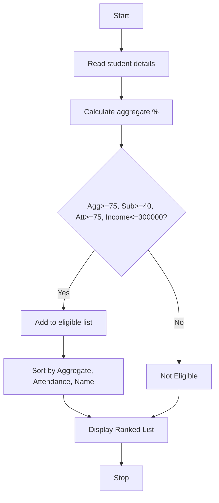

*Problem Statement:* Evaluate applicants using aggregate marks, subject-wise minimum scores, attendance, and income criteria, rank eligible students, and resolve ties using predefined rules.

*Algorithm:*
1. Start
2. Read number of students and details: name, marks list, attendance, income
3. For each student, calculate aggregate percentage
4. Check eligibility: aggregate >= 75, each subject >= 40, attendance >= 75, income <= 300000
5. If eligible, add to list
6. Sort eligible list by aggregate descending, then attendance descending, then name ascending for tie
7. Display ranked list with scholarship amount
8. Stop

*Flowchart:*

*Sample Input:*
Enter number of students: 2
Enter name: Ravi
Enter 3 subject marks separated by space: 85 80 90
Enter attendance %: 88
Enter family income: 200000
Enter name: Priya
Enter 3 subject marks separated by space: 60 55 70
Enter attendance %: 80
Enter family income: 250000
*Sample Output:*
Ravi - Eligible
Priya Not Eligible

Ranked Eligible Students:
1. Ravi - Aggregate: 85.00%, Attendance: 88.0%
---
