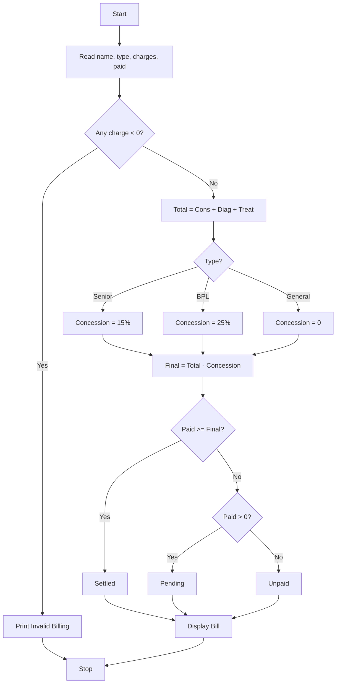

### Problem Statement:
Process consultation, diagnostic, and treatment charges, apply conditional concessions, validate billing constraints, and classify patients according to a supplied payment policy.

### Algorithm:
1. Start
2. Read patient name, type, consultation, diagnostic, treatment charges, amount paid
3. Check if any charge is negative, if yes print Invalid
4. Total = Consultation + Diagnostic + Treatment
5. If type is Senior, concession = 15% of Total
6. Else if type is BPL, concession = 25% of Total
7. Else concession = 0
8. Final Bill = Total - Concession
9. If paid >= Final Bill, status = Settled
10. Else if paid > 0, status = Pending
11. Else status = Unpaid
12. Display bill and status
13. Stop

### Flowchart:

### Sample Input:
Enter patient name: Raju
Enter type (General/Senior/BPL): Senior
Enter consultation charge: 500
Enter diagnostic charge: 1000
Enter treatment charge: 2000
Enter amount paid: 2000

### Sample Output:
Hospital Bill 
Patient: Raju
Total: 3500.0
Concession: 525.0
Final Bill: 2975.0
Paid: 2000.0
Status: Pending

