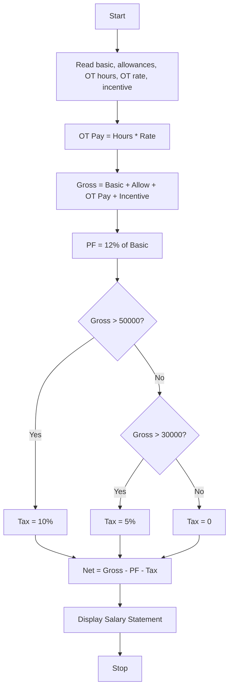

### Problem Statement:
 Employee Payroll and Deduction Analysis: Calculate gross salary from basic pay, allowances, overtime, and incentives; apply progressive deductions and generate a formatted salary statement. 
 
### Algorithm:
1. Start
2. Read employee name, basic, allowances, overtime hours, overtime rate, incentive
3. Calculate Overtime Pay = Hours _ Rate
4. Calculate Gross = Basic + Allowances + Overtime Pay + Incentive
5. Calculate PF = 12% of Basic
6. If Gross > 50000, Tax = 10% of Gross
7. Else if Gross > 30000, Tax = 5% of Gross
8. Else Tax = 0
9. Calculate Net = Gross - PF - Tax
10. Display salary statement
11. Stop

### Flowchart:

### Sample Input:
Enter employee name: Anitha
Enter basic pay: 30000
Enter allowances: 5000
Enter overtime hours: 10
Enter overtime rate: 200
Enter incentive: 3000

### Sample Output:
 Salary Statement 
Employee: Anitha
Gross Salary: 40000.0
PF Deduction: 3600.0
Tax Deduction: 2000.0
Net Salary: 34400.0

Do you want *Case 5* also in same simple format?
