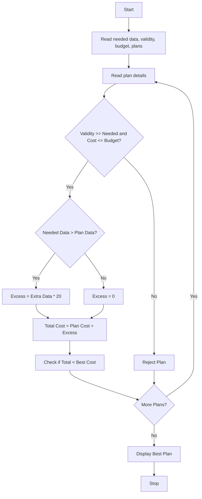

### Problem Statement:
 Multi-Plan Telecommunications Cost Optimization: Evaluate several mobile plans against usage, validity, and budget constraints; calculate excess charges and identify the most economical eligible plan. 

### Algorithm:
1. Start
2. Read needed data, needed validity, budget, number of plans
3. For each plan, read name, cost, data, validity
4. Check if validity >= needed validity and cost <= budget
5. If not eligible, reject plan
6. If eligible, calculate excess data charge if needed
7. Calculate Total Cost = Plan Cost + Excess
8. Keep track of minimum Total Cost plan
9. After all plans, display best plan
10. Stop

### Flowchart:

### Sample Input:
Enter data needed (GB): 50
Enter validity needed (days): 28
Enter budget: 500
Enter number of plans: 2

Plan 1:
Enter plan name: Plan A
Enter plan cost: 299
Enter plan data (GB): 40
Enter plan validity (days): 28

Plan 2:
Enter plan name: Plan B
Enter plan cost: 399
Enter plan data (GB): 60
Enter plan validity (days): 28

### Sample Output:
Plan 1:
Total Cost: 499.0

Plan 2:
Total Cost: 399.0

Best Plan: Plan B
Best Cost: 399.0

