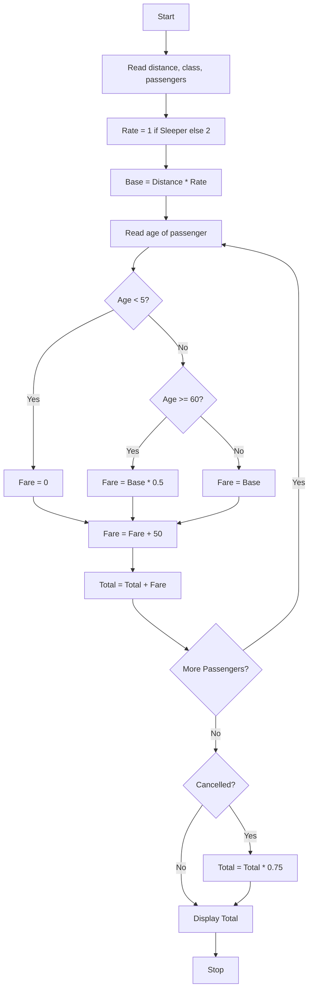

### Problem Statement:
 Railway Fare and Reservation Calculator: Calculate fares for multiple passengers using distance slabs, travel classes, age-based concessions, reservation fees, and specified cancellation penalties.

### Algorithm:
1. Start
2. Read distance, class, number of passengers
3. Set rate: Sleeper = 1, AC = 2
4. Calculate Base Fare = Distance _ Rate
5. For each passenger, read age
6. If age < 5, fare = 0
7. Else if age >= 60, fare = Base _ 0.5
8. Else fare = Base
9. Add reservation fee Rs. 50 to fare
10. Add fare to total
11. If cancelled, Total = Total _ 0.75
12. Display total fare
13. Stop

### Flowchart:

### Sample Input:
Enter distance (km): 200
Enter class (Sleeper/AC): Sleeper
Enter number of passengers: 2
Enter age of passenger 1: 65
Enter age of passenger 2: 30
Cancelled? (yes/no): no

### Sample Output:
Passenger 1 Fare: 150.0
Passenger 2 Fare: 250.0
Total Fare: 400.0
