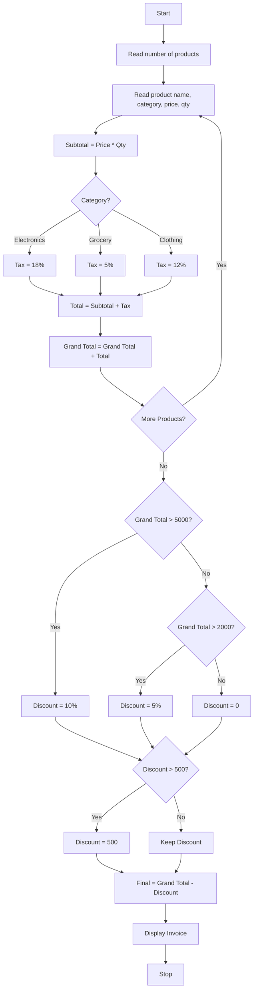

### Problem Statement:
 Retail Billing with Multiple Discount Rules: Process multiple products, quantities, categoryspecific taxes, threshold discounts, and maximum concession limits to generate an itemized invoice. 
 
### Algorithm:
1. Start
2. Read number of products
3. For each product, read name, category, price, quantity
4. Calculate Subtotal = Price * Quantity
5. Calculate Tax based on category
6. Total = Subtotal + Tax
7. Add Total to Grand Total
8. After all products, check discount rule
9. If discount > 500, set discount = 500
10. Final = Grand Total - Discount
11. Display invoice
12. Stop

### Flowchart:

### Sample Input:
Enter number of products: 2

Enter product name: Rice
Enter category (Electronics/Grocery/Clothing): Grocery
Enter price: 100
Enter quantity: 10

Enter product name: Shirt
Enter category (Electronics/Grocery/Clothing): Clothing
Enter price: 1000
Enter quantity: 2

### Sample Output:
Rice: Subtotal 1000.0, Tax 50.0, Total 1050.0
Shirt: Subtotal 2000.0, Tax 240.0, Total 2240.0

 Invoice 
Grand Total: 3290.0
Discount: 164.5
Final Payable: 3125.5
